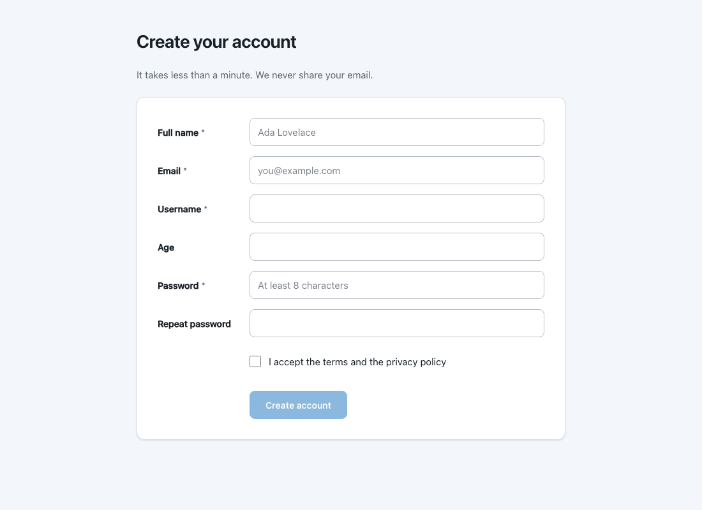

# Trebol

*Rebol's language, in the browser, for beautiful interfaces with no HTML or CSS.*

Trebol is [Rebol](http://www.rebol.com), the language Carl Sassenrath designed, implemented again in
TypeScript so that it runs in a web browser. On top of it is a user interface dialect in the spirit of
Rebol's VID: you describe what a screen is for, and Trebol draws it, accessible, in light and dark, on a
phone or a desktop.

```rebol
view [
    title "New repair"
    form [
        field customer "Customer" required
        money price "Price" EUR min 0
        submit "Save" [save values]
    ]
]
```



Code is data: a screen is a block, so it can be built, stored, checked and changed with the language itself,
like any other value.

## What is in it

- **The language**: Rebol 3's values and evaluation, with exact 64-bit integers, exact money, dates, `parse`,
  objects, maps, errors as values and JSON built in. Where Rebol 3 and Red differ, Trebol usually takes Red's
  way.
- **Tasks that never block**: `fetch`, `wait` and the rest pause only the task that asked, anywhere, even in
  the middle of a `parse`. HTTP, WebSocket and server-sent events are built in.
- **The UI dialect**: forms with validation, tables, lists, dialogs, toasts, tabs, menus, trees, screens with
  their own links, languages, drawings with Red's draw dialect, and charts, in nine looks and five skins, all
  from a theme of a few parameters. No CSS.
- **A console** like Rebol's, and a development server that reloads on save.

## Getting started

Trebol needs Node.js 22.18 or later. There is no build step: Node runs the TypeScript directly.

```sh
npm install
npm run check        # type check and every test
npm run trb          # the console: >> 1 + 2 * 3  == 9
npm run dev          # the examples, at http://localhost:5173/examples/signup/
```

An app is a folder with an `app.trb`; `npx trebol dev that-folder` serves it, with no HTML to write.

## Documentation

`npm run docs:serve` builds the documentation and serves it at http://localhost:8000/. It has two tutorials,
one for the language and one for the screens, where every example is run by the test suite and every UI
example is the real app running under its code; a reference of every function; a guide for people who know
Rebol; and guides to how Trebol is built.

## Layout

| Folder | What is there |
| --- | --- |
| `src/core` | the language: values, `load` and `mold`, binding, the evaluator, natives, `parse` |
| `src/host` | the world: tasks, network, files, the console, the DOM and the theme |
| `src/ui` | the UI dialect, written in Trebol |
| `test` | tests in TypeScript, and the language suites in Trebol (`test/trebol`) |
| `examples` | sample apps: `signup`, `clients`, `gallery`, `screens`, `designer` |
| `docs` | the documentation site |
| `tools` | the `trebol` command, the console, the documentation builders |

## Thanks

Trebol stands on the work of Carl Sassenrath and REBOL Technologies, Nenad Rakočević and the Red team,
Oldes and the contributors to his Rebol 3, Brian Dickens and the Ren-C project, and Rasmus Andersson's
Inter typeface. The first page of the documentation says what each of them gave.
